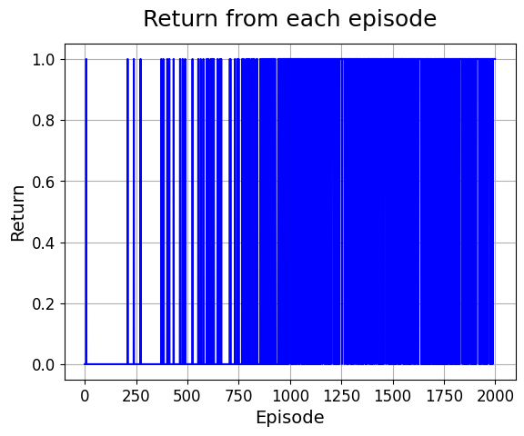
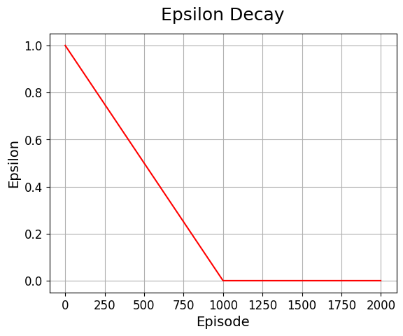

# FrozenLake Q-Learning

FrozenLake 환경에서 Q-learning 알고리즘을 구현하고 에이전트를 학습시킨 강화학습 프로젝트입니다.  
Epsilon-greedy 정책을 적용해 에이전트가 미끄러운 환경에서 탐험과 학습을 반복하도록 구현했습니다.  
2,000회 학습 후 1,000회 평가에서 75.3%의 성공률을 기록했으며, Q-table과 학습 과정을 시각화했습니다.

해당 프로젝트는 Google Colab에서 개발 및 실행된 후, GitHub에 업로드되었습니다.
---

## Introduction

This project explores Reinforcement Learning (RL) by implementing a Q-learning agent in the FrozenLake environment using Gymnasium.

The goal is to train an agent to navigate a frozen grid, avoid holes, and reach the goal. The project explores how an agent learns through interaction with an environment and rewards.

## Project Information

- **Project Period:** 2024.08 
- **Development Environment:** Google Colab
- **Environment:** Gymnasium – FrozenLake-v1

## Project Overview

FrozenLake is a grid-based environment where an agent moves across icy tiles to reach a goal while avoiding holes.

In this project, `is_slippery=True`, meaning the agent may not move in the intended direction because the surface is slippery.

Q-learning is a model-free reinforcement learning algorithm that learns action values for different states. These values are stored in a Q-table and used to select actions.

## Methodology

1. **Environment Setup:** Create the FrozenLake environment using Gymnasium with `is_slippery=True`.
2. **Q-table Initialization:** Initialize a Q-table with zeros for all 16 states and 4 possible actions.
3. **Epsilon-Greedy Policy:** Balance exploration and exploitation when selecting actions.
4. **Training:** Train the agent over 2,000 episodes.
5. **Q-table Update:** Update action values using the Q-learning update rule.
6. **Evaluation:** Evaluate the learned policy over 1,000 episodes and measure its success rate.

## Training Configuration

| Parameter | Value |
|---|---:|
| Training Episodes | 2,000 |
| Learning Rate (alpha) | 0.1 |
| Discount Factor (gamma) | 0.99 |
| Initial Epsilon | 1.0 |
| Epsilon Decay | 0.001 |
| Environment | FrozenLake-v1 |
| Slippery Surface | True |

Epsilon decreases by a fixed amount after each episode until it reaches zero. The agent initially explores different actions and gradually relies more on the learned Q-table.

## Results

The trained agent achieved a **75.3% success rate** over 1,000 evaluation episodes in the recorded evaluation run.

A separate evaluation using the notebook's real-time visualization cell recorded a **73.80% success rate**.

### Training Performance

The following plots illustrate the agent's training process.

**Episode Returns**



**Epsilon Decay**



The notebook also includes:
- A Q-table showing learned action values.
- A visualization of the FrozenLake environment.
- An additional evaluation with real-time environment rendering.

Because the environment is slippery and involves randomness, evaluation results may vary between runs.

## Libraries and Tools

- Python
- Google Colab
- Gymnasium
- NumPy
- Pandas
- Matplotlib

## Development Workflow

The project was developed and executed in Google Colab. The notebook was based on a starter notebook provided as part of an Imperial College London workshop.

I used the provided notebook as a starting point to implement the Q-learning components, configure the training parameters, run the experiment, and evaluate the trained agent. The completed notebook was uploaded to GitHub.

## How to Run

### 1. Clone the repository

```bash
git clone https://github.com/erica2525hi-stack/FrozenLake-qLearning.git
cd FrozenLake-qLearning
```

### 2. Open the notebook

Open the Jupyter Notebook in Google Colab.

### 3. Run the notebook

